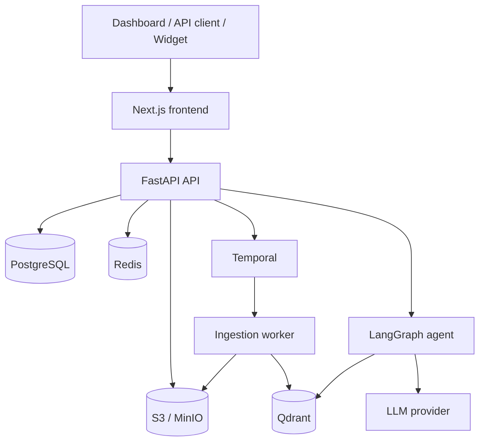

# AutoRAG

[](https://github.com/RahulAgarwal701/AutoRAG/actions/workflows/ci.yml)

AutoRAG is a multi-tenant platform for building, evaluating, and deploying
document-grounded AI agents. It combines durable document ingestion, hybrid vector
retrieval, a citation-aware LangGraph runtime, a public API, and an embeddable chat
widget in one production-oriented repository.

## Features

- Authenticated dashboard for creating and configuring RAG agents.
- PDF, DOCX, TXT, Markdown, and HTML ingestion through S3-compatible storage.
- Durable Temporal workflows with retries, timeouts, idempotent vector IDs, and cleanup.
- Dense and sparse retrieval with reciprocal rank fusion and optional Cohere reranking.
- Gemini, Grok, OpenAI, and Claude answer providers.
- Streaming Server-Sent Events with validated inline citations and persisted sessions.
- Tenant and agent isolation across PostgreSQL, Qdrant, object storage, and API keys.
- Browser-safe widget with short-lived origin-bound sessions and per-agent iframe CSP.
- Golden Q&A sets, synthetic question generation, RAGAS metrics, hit-rate@k, and MRR.
- Sentry, Langfuse, structured PII-safe logs, and token-protected Prometheus metrics.
- Render and Vercel deployment configurations with an in-process worker fallback.

## Architecture



Document ingestion is asynchronous: the API stores the original file and starts a
Temporal workflow; the worker parses, chunks, embeds, and upserts it into Qdrant.
Chat requests use the agent graph to rewrite the query, retrieve tenant-scoped
context, grade relevance, optionally call tools, and generate a cited response.

## Tech stack

| Layer | Technology |
|---|---|
| Frontend | Next.js 16, React 19, TypeScript, Tailwind CSS |
| API | FastAPI, Pydantic v2, SQLAlchemy 2 async, Alembic |
| Agent runtime | LangGraph, Gemini, xAI Grok, OpenAI, Anthropic |
| Retrieval | Qdrant, Gemini embeddings, BM25 or SPLADE, RRF, Cohere rerank |
| Workflows | Temporal Python SDK |
| Data | PostgreSQL, Redis, AWS S3 or MinIO |
| Evaluation | RAGAS, hit-rate@k, mean reciprocal rank |
| Observability | Sentry, Langfuse, Prometheus exposition |
| Delivery | Docker, GitHub Actions, Render, Vercel |

## Repository layout

```text
backend/              FastAPI API, agent runtime, workflows, migrations, tests
frontend/             Next.js dashboard, API proxy, embed page, widget loader
infra/                Local Docker Compose services and Temporal configuration
docs/                 Render and Vercel deployment runbooks
examples/             Cross-origin widget demo
render.yaml           Production Render Blueprint
render.free.yaml      Single-service free-tier Blueprint
```

## Local setup

### Prerequisites

- Docker with Docker Compose
- A Gemini API key for embeddings and the default answer model
- Optional: `uv`, Python 3.12, and Node.js 20 for host-based development

### Run the complete stack

```bash
git clone https://github.com/RahulAgarwal701/AutoRAG.git
cd AutoRAG
cp .env.example .env
```

Set at least this value in `.env`:

```env
GEMINI_API_KEY=your-key
```

Then start the services:

```bash
make dev
```

| Service | URL |
|---|---|
| Dashboard | http://localhost:3000 |
| API health | http://localhost:8000/health |
| OpenAPI | http://localhost:8000/docs |
| Temporal UI | http://localhost:8080 |
| MinIO console | http://localhost:9001 |
| Qdrant dashboard | http://localhost:6333/dashboard |

Run migrations and checks manually with:

```bash
make migrate
make test

cd backend
uv run ruff check app migrations tests
uv run ruff format --check app migrations tests
uv run mypy app
uv run pip-audit --ignore-vuln PYSEC-2026-2447 --ignore-vuln PYSEC-2026-3046

cd ../frontend
npm run lint
npm run typecheck
npm audit --audit-level=high
npm run build
```

## Configuration notes

- The default embedding model is `gemini-embedding-001` with 1,536 dimensions.
- New agents default to Gemini; set `XAI_API_KEY` for Grok agents.
- `COHERE_API_KEY` is required only when an agent enables reranking.
- `MAX_UPLOAD_SIZE_MB` limits validated document bytes; `MAX_REQUEST_BODY_SIZE_MB`
  provides a global limit for declared and chunked HTTP request bodies.
- For local storage, MinIO implements the S3 interface. Production uses AWS S3.
- Set `RUN_TEMPORAL_WORKER_IN_PROCESS=true` only for the single-service fallback.

See [.env.example](.env.example) for the complete variable list.

## API examples

### Sign up

```bash
curl -sS -X POST http://localhost:8000/api/v1/auth/signup \
  -H 'Content-Type: application/json' \
  -d '{"email":"developer@example.com","password":"change-this-password"}'
```

Save the returned `access_token`:

```bash
export ACCESS_TOKEN='<access-token>'
```

### Create an agent

```bash
curl -sS -X POST http://localhost:8000/api/v1/agents \
  -H "Authorization: Bearer $ACCESS_TOKEN" \
  -H 'Content-Type: application/json' \
  -d '{
    "name":"Policy assistant",
    "system_prompt":"Answer clearly from the supplied policy documents.",
    "llm_provider":"gemini",
    "model":"gemini-3.5-flash-lite",
    "top_k":5,
    "use_reranker":false
  }'
```

```bash
export AGENT_ID='<agent-uuid>'
```

### Upload a document

```bash
curl -sS -X POST "http://localhost:8000/api/v1/agents/$AGENT_ID/documents" \
  -H "Authorization: Bearer $ACCESS_TOKEN" \
  -F 'file=@policy.pdf'
```

Poll `GET /api/v1/agents/$AGENT_ID/documents` until the document status is `ready`.

### Stream dashboard chat

```bash
curl -N -X POST "http://localhost:8000/api/v1/agents/$AGENT_ID/chat/stream" \
  -H "Authorization: Bearer $ACCESS_TOKEN" \
  -H 'Content-Type: application/json' \
  -d '{"message":"How long is the refund period?"}'
```

### Public agent API

Create an agent API key from the dashboard or
`POST /api/v1/agents/$AGENT_ID/api-keys`. The plaintext key is shown once.

```bash
export AGENT_API_KEY='ark_live_<secret>'

curl -sS -X POST "http://localhost:8000/v1/agents/$AGENT_ID/chat" \
  -H "Authorization: Bearer $AGENT_API_KEY" \
  -H 'Content-Type: application/json' \
  -d '{"message":"Summarize the cancellation policy.","stream":false}'
```

The JSON response contains `session_id`, `answer`, `citations`, and token `usage`.
Use `"stream": true` to receive SSE.

### Embeddable widget

Add the customer site's exact origin to the agent allowlist, then include:

```html
<script
  src="https://<app>.vercel.app/widget.js"
  data-agent-id="<agent-uuid>">
</script>
```

The browser receives a short-lived token bound to the agent and parent origin, never
the long-lived agent API key. See [examples/widget-demo.html](examples/widget-demo.html)
for a cross-origin test page.

## Evaluation

Store manual golden cases through
`POST /api/v1/agents/{agent_id}/evaluation-cases`, or generate up to 25 seed cases
from indexed chunks with
`POST /api/v1/agents/{agent_id}/evaluation-cases/synthetic`.

Run the standard four-way comparison:

```bash
cd backend
uv run python -m app.scripts.evaluate \
  --tenant-id "$TENANT_ID" \
  --agent-id "$AGENT_ID" \
  --output ../evaluation-report.md
```

### Evaluation results

No production corpus evaluation is committed yet. The table is intentionally marked
pending rather than presenting fixture values as benchmark results. Running the command
above produces this table with measured values from the selected agent's persisted
golden set.

| Configuration | Retrieval | Reranker | Faithfulness | Answer relevancy | Context precision | Context recall | Hit-rate@k | MRR |
|---|---|---:|---:|---:|---:|---:|---:|---:|
| Hybrid | Dense + sparse RRF | No | Pending | Pending | Pending | Pending | Pending | Pending |
| Dense | Dense only | No | Pending | Pending | Pending | Pending | Pending | Pending |
| Hybrid + reranker | Dense + sparse RRF | Yes | Pending | Pending | Pending | Pending | Pending | Pending |
| Dense + reranker | Dense only | Yes | Pending | Pending | Pending | Pending | Pending | Pending |

RAGAS scores use an LLM judge. Hit-rate@k and MRR are deterministic from the labeled
reference document IDs. Reranker configurations are reported as skipped when Cohere
is not configured.

## Security

- JWT authentication and Argon2 password hashing for dashboard users.
- Hashed, revocable `ark_live_` API keys and short-lived origin-bound widget tokens.
- Exact per-agent origin allowlists, dynamic CORS, and per-agent `frame-ancestors` CSP.
- Tenant and agent filters on database and vector retrieval paths.
- Redis rate limits for IPs, API keys, and widget-session creation.
- Global request-body and document-size limits, MIME checks, safe filenames, and UTF-8
  validation.
- Retrieved documents and tool output are explicitly treated as untrusted data in the
  system prompt; embedded instructions cannot supersede agent rules.
- Structured logs recursively redact emails, credentials, bearer tokens, API keys,
  JWTs, and URL passwords. Sentry runs with default PII collection disabled and an
  additional event scrubber.
- CI runs `pip-audit` and `npm audit` against locked dependencies.

The Python audit temporarily suppresses `PYSEC-2026-2447` (`diskcache`) and
`PYSEC-2026-3046` (`ragas`) because neither advisory currently publishes a fixed
release. All fixable audit findings remain CI-blocking; remove these exceptions as soon
as patched upstream versions are available.

Prompt-injection mitigation is defense in depth, not a guarantee. Keep external tools
least-privileged, allowlist webhook hosts, and review sensitive deployments separately.

## Observability

- `SENTRY_DSN` enables FastAPI exception and trace capture.
- Langfuse credentials enable chat and evaluation traces and scores.
- `/metrics` exposes request counts, in-progress requests, and bounded latency
  histograms when called with `Authorization: Bearer $METRICS_TOKEN`.
- Application logs are emitted as structured JSON without request bodies.

## Continuous integration and deployment

[.github/workflows/ci.yml](.github/workflows/ci.yml) runs on pull requests and pushes
to `main`:

1. Ruff lint and format checks, mypy, and Python dependency audit.
2. Alembic migrations and backend tests against PostgreSQL, Redis, and Qdrant service
   containers.
3. Frontend lint, typecheck, dependency audit, and optimized build.
4. Backend and production frontend Docker builds.

`render.yaml` uses `autoDeployTrigger: checksPass`, so the API and worker deploy from
the connected `main` branch only after GitHub checks pass. Connect the GitHub repository
to Vercel, set `frontend` as its Root Directory, and select `main` as the Production
Branch; pushes to `main` then create production deployments.

Detailed deployment runbooks:

- [Render deployment](docs/render-deployment.md)
- [Vercel deployment](docs/vercel-deployment.md)

## Design decisions

### Why Temporal?

Ingestion spans object storage, parsing, chunking, embedding, vector upserts, and status
updates. These operations can fail independently and often outlive an HTTP request.
Temporal provides durable execution, activity-level retries and timeouts, observable
workflow state, and deterministic workflow IDs. That gives AutoRAG recovery behavior
without building a custom queue and retry state machine.

### Why hybrid search?

Dense vectors are strong at semantic similarity but can miss exact identifiers, names,
codes, and uncommon terms. Sparse retrieval preserves lexical matches. AutoRAG retrieves
both candidate sets and combines them with reciprocal rank fusion, avoiding assumptions
that the two score scales are directly comparable. Dense-only mode remains available for
evaluation and simpler deployments.

### Why LangGraph?

The chat path is more than one prompt: it rewrites conversational queries, retrieves,
grades context, decides whether tools are relevant, generates, and falls back safely.
LangGraph makes those transitions explicit and testable while retaining shared state for
citations and token accounting. It also leaves room for adding guardrails or human review
without turning the request handler into an implicit control-flow pipeline.

## License

No license has been added yet. Until one is provided, the repository remains all rights
reserved by its owner.
